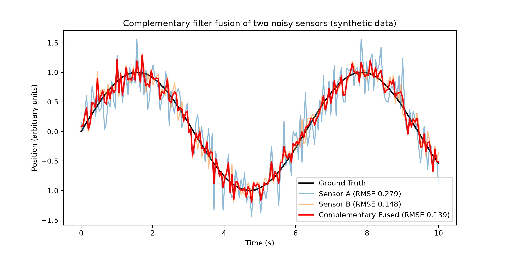
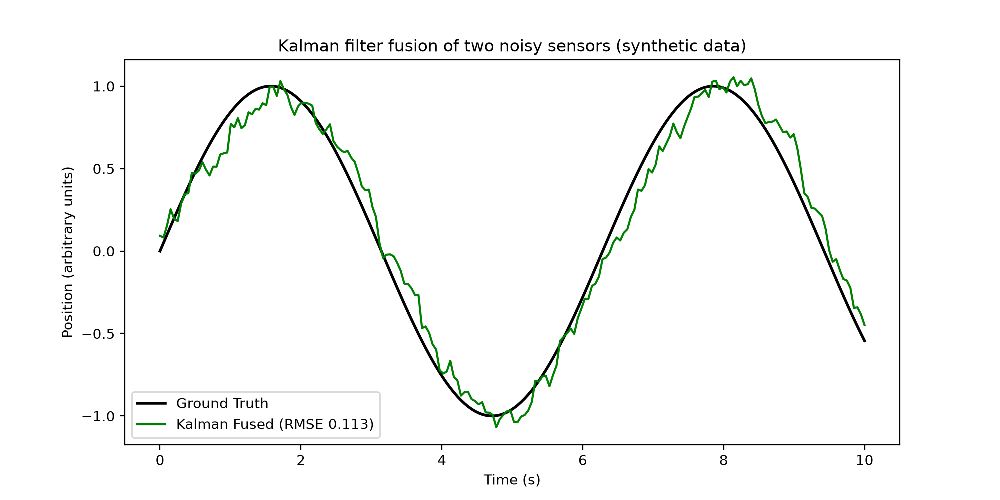

# MicroSense Fusion

A small Python simulation of two-sensor fusion on synthetic data. It compares a fixed-weight complementary filter and a simple 1D Kalman filter against each sensor on its own.

## Why this exists

Miniaturized continuum surgical robots (especially below 5 mm) mostly rely on one sensing method at a time, such as fiber-optic shape sensing, strain sensing, vision-based tactile sensing or electromagnetic tracking. Each has its own accuracy, size and reliability limits. Combining two or more methods in one instrument is rare. This project is a first, software-only step into that gap: before building hardware, I wanted to see how much fusing two imperfect readings of the same quantity actually helps, and what it costs.

## What it does

- Generates a sine wave as the "true" position of a robot tip (the ground truth).
- Creates two simulated sensors by adding Gaussian noise to the truth: Sensor A (noise std 0.3) and Sensor B (noise std 0.15).
- Fuses them two ways:
  - **Complementary filter:** a fixed weighted average (0.7 on Sensor B, 0.3 on Sensor A).
  - **1D Kalman filter:** averages the two readings, then updates a running estimate with an adaptive gain.
- Prints the RMSE of each against the ground truth and saves two plots.

## Results (seed 42)

| Estimate | RMSE |
|---|---|
| Sensor A | 0.279 |
| Sensor B | 0.148 |
| Complementary filter | 0.139 |
| Kalman filter | 0.113 |

In this run, both filters beat each sensor on its own. The complementary filter improved on the better sensor (B) by about 6%. The Kalman filter improved on it by about 24%. The Kalman estimate is smoother but visibly lags the true signal.

Plots: `


`.

## What I learnt

- Fusion helps, but the gain depends on how good the better sensor already is. With fixed weights and one clearly better sensor, the improvement was small.
- The Kalman filter did better on RMSE, but it traded noise for delay. Its estimate trails the true signal, which matters for a robot that needs to know where its tip is right now.
- Filter settings (weights, noise parameters) were set by hand and change the result. Tuning them properly is the next step.

## Limitations

- All data is synthetic. No real sensor is read.
- Both sensors have zero-mean Gaussian noise and differ only in size. Real sensing methods also drift, saturate or fail in different ways.
- The Kalman filter is 1D, assumes position changes slowly between steps, and averages the two sensors before filtering instead of weighting each by its own noise level.
- Results come from a single random seed. Other seeds will give slightly different numbers.

## Run it

```
pip install numpy matplotlib
python microsensefusion.py
```

## Next steps

- Run many random seeds and report the mean and spread of RMSE.
- Update the Kalman filter once per sensor, each with its own noise level.
- Feed it real sensor readings from hardware (for example an Arduino or ESP32 reading two cheap sensors).
